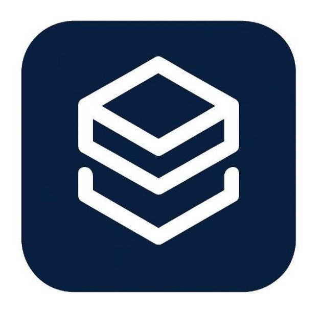

# ServiceOps — Enterprise IT Service Management & Operations Platform

<div align="center">



**Next-Generation IT Service Management, SLA Automation & Incident War Room Platform**

[](.github/workflows/ci.yml)
[](docs/ServiceOps_Software_Requirements_Specification_SRS.md)
[](docs/ServiceOps_Project_Proposal.md)
[](docs/ServiceOps_Software_Requirements_Specification_SRS.md)
[](docker-compose.yml)
[](LICENSE)

</div>

---

## 🌟 Overview

**ServiceOps** is an open-source, production-grade IT Service Management (ITSM) and Enterprise Operations platform. Engineered as a high-performance alternative to legacy platforms like ServiceNow and Jira Service Management, ServiceOps unifies employee self-service, IT triage queues, SLA breach prevention, Configuration Management (CMDB), Major Incident War Rooms, and a cryptographic tamper-evident audit ledger into a single cohesive system.

---

## ✨ Key Capabilities

- 🎯 **ITIL v4 Service Desk:** 7-state lifecycle machine (`NEW` &rarr; `ASSIGNED` &rarr; `IN_PROGRESS` &rarr; `RESOLVED` &rarr; `CLOSED`), dynamic 3x3 Impact x Urgency priority matrix, and private internal notes (`INTERNAL_NOTE`) vs. customer communications.
- ⏱️ **Business-Hours SLA Engine:** 4-tier SLA policies with automated 75% breach warnings and dynamic business hours calculations that automatically pause countdown timers on weekends and outside 08:00–18:00.
- 🖥️ **Hardware CMDB & Asset Correlation:** Centralized inventory of laptops, desktops, docks, monitors, and licenses with unique asset tags, serial numbers, warranty tracking, and bidirectional ticket incident correlation.
- 🚨 **Major Incident War Room Command:** P1 outage declaration, Incident Commander assignment, live broadcast operational timeline, and structured Root Cause Analysis (RCA).
- 🔒 **Cryptographic Tamper-Evident Audit Ledger:** Append-only SHA-256 block-chained ledger with automated sensitive credential scrubbing (`[REDACTED]`) and instant mathematical integrity verification (`GET /api/v1/audit/verify`).
- 🛡️ **Enterprise Security & 6-Digit OTP:** Argon2id password hashing, registration approval workflow, and 30-minute cryptographically secure numeric OTP reset.
- ⚡ **Real-Time WebSockets:** Socket.io event bus for instant ticket updates, typing indicators, and war room collaboration.

---

## 🚀 60-Second Quickstart (Docker)

Anyone can spin up the full ServiceOps platform with a single command.

### macOS & Linux
```bash
git clone https://github.com/your-org/ServiceOps.git
cd ServiceOps
chmod +x setup.sh
./setup.sh
```

### Windows
Double-click `setup.bat` or run:
```cmd
git clone https://github.com/your-org/ServiceOps.git
cd ServiceOps
setup.bat
```

The script will automatically configure your `.env`, initialize PostgreSQL and Redis, run schema migrations, seed test data, and launch the web portal at **http://localhost:3000**.

---

## 🔑 Pre-Seeded Default Accounts

| Role | Email | Password | Access Scope |
| :--- | :--- | :--- | :--- |
| **System Administrator** | `admin@serviceops.com` | `Admin@123` | Full system governance, approvals, audit verification |
| **IT Manager** | `manager@serviceops.com` | `Manager@123` | Queue triaging, War Room command, SLA policies |
| **Support Agent** | `agent@serviceops.com` | `Agent@123` | Ticket resolution, private notes, CMDB asset lookup |
| **Employee Requester** | `employee@serviceops.com` | `Employee@123` | Self-service catalog, public replies, closure acceptance |

---

## 💻 Local Development Setup (Without Docker)

### Prerequisites
- Node.js 20 LTS or higher
- PostgreSQL 14+ running locally on port 5432
- Redis 7+ running locally on port 6379 (optional, defaults to in-memory)

### 1. Backend Setup
```bash
cd backend
cp .env.example .env
npm install
npx prisma db push
npx ts-node prisma/seed.ts
npm run start:dev
```
*Backend API will run at `http://localhost:4000`, with Swagger documentation at `http://localhost:4000/docs`.*

### 2. Frontend Setup
```bash
cd frontend
cp .env.example .env.local
npm install
npm run dev
```
*Frontend UI will run at `http://localhost:3000`.*

---

## 🏗️ System Architecture

```
+---------------------------------------------------------------------------------------------+
|                                    SERVICEOPS ARCHITECTURE                                  |
+---------------------------------------------------------------------------------------------+
|                                                                                             |
|   +-----------------------+              HTTPS / WSS              +---------------------+   |
|   |  Employee / Requester | <-----------------------------------> |  Self-Service Desk  |   |
|   +-----------------------+                                       +---------------------+   |
|                                                                                             |
|   +-----------------------+              HTTPS / WSS              +---------------------+   |
|   |  IT Support Personnel | <-----------------------------------> |  Agent Workspace /  |   |
|   |  (Agents & Managers)  |                                       |  Incident War Room  |   |
|   +-----------------------+                                       +---------------------+   |
|                                                                                             |
|   +-----------------------+              HTTPS / WSS              +---------------------+   |
|   |  System Administrator | <-----------------------------------> |  Admin & Audit Deck |   |
|   +-----------------------+                                       +---------------------+   |
|                                                                                             |
|                                          |                                                  |
|                                          v                                                  |
|                      +---------------------------------------+                              |
|                      |        ServiceOps Core API Engine     |                              |
|                      |  (NestJS 10 + Prisma ORM + PostgreSQL)|                              |
|                      +-------------------+-------------------+                              |
|                                          |                                                  |
|                 +------------------------+------------------------+                         |
|                 |                                                 |                         |
|                 v                                                 v                         |
|    +-------------------------+                       +-------------------------+            |
|    |  PostgreSQL 16 Database |                       |   Brevo Email Service   |            |
|    |  (ACID Relational Core) |                       | (Transactional Delivery)|            |
|    +-------------------------+                       +-------------------------+            |
+---------------------------------------------------------------------------------------------+
```

---

## 📚 Documentation & Specifications

- 📘 [Production Deployment & DevOps Manual](DEPLOYMENT.md) — VPS provisioning, Nginx, Let's Encrypt SSL, and automated backups.
- 🏢 [SaaS Multi-Tenant Architecture Transformation Guide](docs/ServiceOps_SaaS_Architecture_Transformation_Guide.md) — Blueprint for converting ServiceOps into a commercial B2B SaaS platform.
- 📄 [Software Requirements Specification (IEEE 830 SRS)](docs/ServiceOps_Software_Requirements_Specification_SRS.md) — Complete requirements specification with Requirements Traceability Matrix.
- 💼 [Project Proposal & Executive ROI Blueprint](docs/ServiceOps_Project_Proposal.md) — Business case, technical roadmap, and cost-benefit analysis.

---

## 🧪 Testing & Quality Assurance

ServiceOps features an automated test suite verifying 100% of core engine functionalities across 124 formal test cases:

```bash
# Run unit tests
cd backend && npm test

# Run E2E and security tests
npm run test:e2e
```
