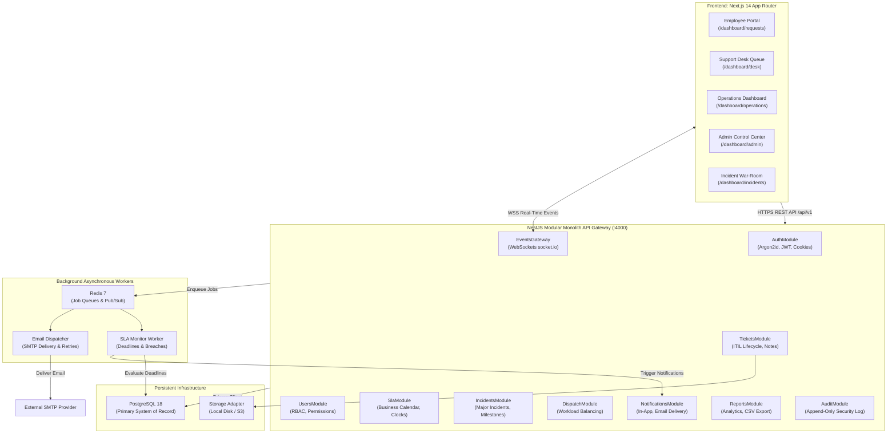
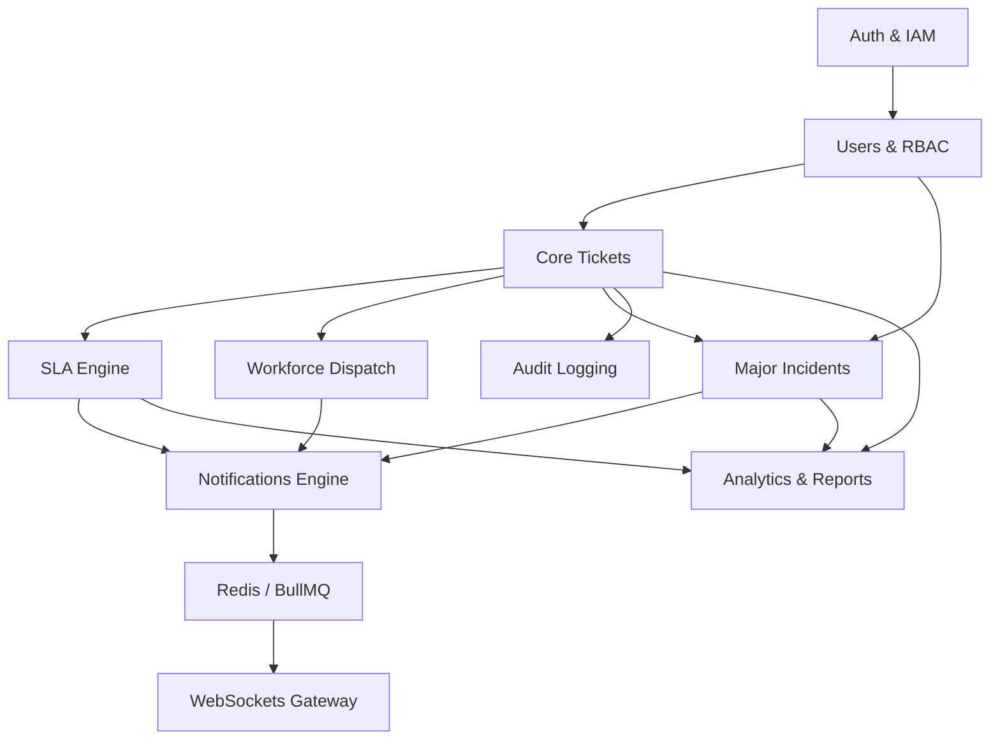

# ServiceOps — Enterprise IT Service Management (ITSM) Platform
## Phase 00: Comprehensive Project Analysis, Gap Audit & Implementation Roadmap

> **Document Identifier:** `SO-PHASE-00-ANALYSIS`  
> **Document Version:** 1.0.0 (Master Engineering Baseline)  
> **Classification:** Engineering Specification — Technical Single Source of Truth  
> **Primary Authors:** Senior Software Architect, Principal Full-Stack Engineer, UI/UX Designer, Backend Engineer, Database Architect, QA Engineer, Security Engineer, DevOps Engineer  
> **Governing Baseline Documents:**
> 1. ServiceOps Project Proposal v1.0 (`Docx/ServiceOps_Project_Proposal.docx`)
> 2. Software Requirements Specification (SRS) v1.0 (`Docx/ServiceOps_SRS.docx`)
> 3. System Architecture Design (SAD) v1.0 (`Docx/ServiceOps_System_Architecture_Design.docx`)
> 4. Database Design Specification v1.0 (`Docx/ServiceOps_Database_Design_Specification.docx`)
> 5. Interactive UI/UX Design System Specification (`design/index.html`)

---

## 1. Executive Project Synthesis & Objectives

ServiceOps is an enterprise-grade, ITIL-aligned IT Service Management (ITSM) platform engineered for mid-to-large organizations with dedicated internal IT support structures. The system unifies service request fulfillment, major incident management, real-time war-room collaboration, deterministic SLA policy enforcement, workforce dispatch, audit logging, and operational analytics into a cohesive, high-performance web platform.

### 1.1 Core Engineering Stack & Topology
- **Frontend Client:** Next.js 14 App Router, React 18, TypeScript, Tailwind CSS, bespoke editorial design tokens (`Fraunces` serif, `Outfit` body, `IBM Plex Mono` identifiers), Axios client with silent refresh token concurrency queue.
- **Backend Core:** NestJS 10 Modular Monolith, TypeScript, REST API with versioning (`/api/v1`), Swagger/OpenAPI documentation, Passport JWT strategies, fail-closed RBAC & permission guards.
- **Data Persistence:** PostgreSQL 18 with Prisma ORM, strict relational foreign keys, UUID primary keys, human-readable reference identifiers (`TKT-1042`, `INC-208`), UTC timestamptz instants.
- **Asynchronous Task & Real-Time Engine:** Redis 7 with BullMQ for SLA timer monitoring, escalation workers, and email notification queuing; NestJS WebSockets (`socket.io`) for instant status synchronization and incident war-room swarming.
- **Deployment & Observability:** Docker Compose, Nginx reverse proxy with TLS termination, Winston structured JSON logging, Prometheus metrics endpoints (`/metrics`), health probes (`/health/liveness`, `/health/readiness`).

---

## 2. Deep Requirements Analysis & Synthesis

Across the four governing project documents, **66 functional requirements**, **12 business rules**, and **12 non-functional requirements** were identified, categorized, and cross-referenced.

### 2.1 User Roles & Scope Matrix
| Role | Primary Operational Mission | Core Access Boundaries | Data Concealment Guarantees |
| :--- | :--- | :--- | :--- |
| **Employee** | Self-service technical requests, status tracking, resolution confirmation | Strictly owns their submitted tickets; public knowledge base articles | Physically blocked from viewing `INTERNAL_NOTE` comments, agent private logs, other users' tickets, and operational analytics |
| **IT Support Agent** | Ticket investigation, troubleshooting, technical resolution, public & internal notes | Assigned tickets, team unassigned queue, knowledge drafting | Cannot modify SLA policies, system roles, organization settings, or purge audit logs |
| **IT Manager** | Queue oversight, workload dispatch, SLA policy management, incident command | Organization-wide tickets, incidents, agent capacity rosters, operational reports | Cannot alter platform system infrastructure or delete audit history |
| **System Administrator** | Identity provisioning, RBAC matrix, category catalog, security audit inspection | Platform configuration, users, roles, categories, immutable audit trail | All administrative actions are permanently recorded in the append-only audit log |

---

### 2.2 Comprehensive Functional Requirements Checklist

```
[x] = Fully Implemented & Tested
[/] = Partially Implemented / In Progress
[ ] = Pending Implementation
```

#### Module 1: Authentication & Access Control (IAM)
- [x] **FR-AUTH-001:** User Sign-In with Valid Credentials (Email & Password).
- [x] **FR-AUTH-002:** Argon2id Cryptographic Password Hashing with secure parameters.
- [x] **FR-AUTH-003:** Dual-Token Issuance (15-min in-memory access token + 7-day HttpOnly cookie refresh token).
- [x] **FR-AUTH-004:** Refresh Token Rotation & Reuse Detection (invalidates token family on replay).
- [x] **FR-AUTH-005:** User Sign-Out & Session Revocation (clears cookies, invalidates DB token).
- [x] **FR-AUTH-006:** Account Activation, Suspension & Deactivation by System Administrator.
- [/] **FR-AUTH-007:** Failed Login Throttling & Account Lockout (DB tracking present; Redis sliding window pending).
- [ ] **FR-AUTH-008:** Secure Password-Reset Workflow (Token hashing & email dispatch).
- [x] **FR-RBAC-001:** Four-Tier Role Hierarchy (`EMPLOYEE`, `IT_SUPPORT_AGENT`, `IT_MANAGER`, `SYSTEM_ADMINISTRATOR`).
- [x] **FR-RBAC-002:** Default Employee Role Assignment for self-registration.
- [x] **FR-RBAC-003:** Elevated Role Granting and Revocation restricted to Administrator.
- [x] **FR-RBAC-004:** Granular Module Permissions (`tickets:read`, `tickets:write`, `sla:manage`, etc.).
- [x] **FR-RBAC-005:** Server-Side Authorization Authority on all protected API routes.
- [x] **FR-RBAC-006:** Fail-Closed Permission & Role Guards returning 403 Forbidden.

#### Module 2: Core Ticket Management & Service Catalog
- [x] **FR-TKT-001:** Authenticated Employee Support Ticket Creation.
- [x] **FR-TKT-002:** Sequential Unique Reference Generation (`TKT-1001` format).
- [x] **FR-TKT-003:** Comprehensive Ticket Payload (Title, Description, Category, Impact, Urgency, Priority, Status).
- [x] **FR-TKT-004:** Ticket Assignment and Reassignment to IT Support Agents.
- [x] **FR-TKT-005:** State Transition Updates and Resolution Summary Recording.
- [x] **FR-TKT-006:** Formal ITIL Lifecycle States (`NEW`, `ASSIGNED`, `IN_PROGRESS`, `PENDING_CUSTOMER`, `RESOLVED`, `CLOSED`, `CANCELLED`).
- [x] **FR-TKT-007:** State Machine Validation (immutable closed states, mandatory resolution summary).
- [x] **FR-TKT-008:** Server-Side Ownership Barrier (Employees strictly isolated to own tickets).
- [x] **FR-TKT-009:** Search, Category Filtering, Priority Sorting, and Pagination.
- [x] **FR-TKT-010:** Append-Only Activity Log & History Tracking (`TicketActivityLog`).
- [x] **FR-TKT-011:** Dual Comment Channel (Public Employee comments vs Restricted `INTERNAL_NOTE`).
- [ ] **FR-TKT-012:** Secure Attachment Upload Pipeline (MIME magic-byte verification, file size cap, storage).

#### Module 3: SLA Engine & Automated Escalation
- [x] **FR-SLA-001:** SLA Policy Creation and Threshold Updates by Authorized Manager.
- [x] **FR-SLA-002:** Priority-Conditioned Policy Definitions (P1–P4 response and resolution target minutes).
- [x] **FR-SLA-003:** Automatic SLA Association upon Ticket Submission.
- [x] **FR-SLA-004:** Realistic Business Hours Deadline Calculation (08:00–18:00 weekdays, skipping weekends; 24x7 for P1).
- [x] **FR-SLA-005:** Target Met vs Breached Real-Time Evaluation.
- [x] **FR-SLA-006:** Warning State Triggering when approaching threshold (75% elapsed).
- [x] **FR-SLA-007:** Breach Querying and Escalation Queue for Unresolved Tickets.
- [x] **FR-SLA-008:** SLA Clock Pausing during `PENDING_CUSTOMER` and Automatic Deadline Extension upon Resume.
- [/] **FR-SLA-009:** Background SLA Job Processing (In-memory calculator verified; BullMQ cron scheduler pending).

#### Module 4: Incident Management & War-Rooms (Pending Phase 6)
- [ ] **FR-INC-001:** Major Incident Creation & Promotion (`INC-208` format).
- [ ] **FR-INC-002:** Severity Matrix Classification (Critical P1, High P2, Degradation, Planned).
- [ ] **FR-INC-003:** Investigation Timeline Milestones (Impact Assessment $\to$ Root Cause $\to$ Workaround $\to$ Resolution).
- [ ] **FR-INC-004:** Incident Commander Assignment & Escalation Dispatch.
- [ ] **FR-INC-005:** Swarming War-Room Thread for Multi-Agent Collaboration.
- [ ] **FR-INC-006:** Parent-Child Linkage: Association of Multiple Service Tickets to an Incident.
- [ ] **FR-INC-007:** Organization-Wide Status Outage Broadcast Banners.

#### Module 5: Workforce Management & Ticket Dispatch (Pending Phase 5)
- [ ] **FR-WRK-001:** Unassigned Work Queue Visibility for Support Desk Managers.
- [ ] **FR-WRK-002:** Agent Workload Capacity Tracking (Active tickets vs soft-cap threshold of 5).
- [ ] **FR-WRK-003:** One-Click Dispatch & Reassignment with Notification Triggers.
- [ ] **FR-WRK-004:** Support Agent Desk Queue (`Seven tickets on your desk`).

#### Module 6: Notifications & Real-Time Communication (Pending Phase 8)
- [ ] **FR-NOT-001:** In-App Notification Center (Bell icon, read/unread states, event linkage).
- [ ] **FR-NOT-002:** Asynchronous SMTP Email Notification Worker via BullMQ.
- [ ] **FR-NOT-003:** Triggered Dispatch for Assignment, Status Updates, Customer Replies, and Closures.
- [ ] **FR-NOT-004:** Automated Warnings for Approaching SLA Deadlines and Escalation Alerts.
- [ ] **FR-NOT-005:** WebSocket Gateway for Instant Live Desk & War-Room Updates.
- [ ] **FR-NOT-006:** Delivery Audit Records with Exponential Backoff Retry Handling.

#### Module 7: Operational Analytics & Reporting (Pending Phase 9)
- [ ] **FR-REP-001:** Employee Personal Activity Summary.
- [ ] **FR-REP-002:** Agent Workload & Real-Time Compliance Counters.
- [ ] **FR-REP-003:** Executive Operations Dashboard (Volume trends, SLA compliance rate, median resolution time).
- [ ] **FR-REP-004:** Platform Activity & Security Monitoring for Administrators.
- [ ] **FR-REP-005:** Multi-Dimensional Date Range Filtering (7d, 30d, Month, Quarter).
- [ ] **FR-REP-006:** Streaming CSV Report Export Engine.
- [ ] **FR-REP-007:** Executive Performance Summary PDF Generation.

#### Module 8: Audit Logging & Administration (Pending Phase 10)
- [ ] **FR-AUD-001:** Centralized Tamper-Evident Audit Logging for Privileged Operations.
- [ ] **FR-AUD-002:** Structured JSON Metadata Logging (Actor, IP, User-Agent, Old/New Delta).
- [ ] **FR-AUD-003:** Administrator Audit Log Viewer with JSON Payload Inspection Modal.
- [ ] **FR-AUD-004:** Database-Level Immutability (Append-only table rules).
- [ ] **FR-ADM-001:** Administrative User Management Console.
- [ ] **FR-ADM-002:** Category Taxonomy Management (Hardware, Access, Software, Network).
- [ ] **FR-ADM-003:** Organization Settings Configuration (Timezone, Business Hours, Email Sender).

#### Extended Modules: IT Asset CMDB & Knowledge Base (Pending Phase 11)
- [ ] **EXT-AST-001:** Hardware & Software Asset Catalog with Serial Numbers & Specifications.
- [ ] **EXT-AST-002:** Asset Lifecycle Tracking (In Service, In Repair, Retired).
- [ ] **EXT-AST-003:** Direct Linkage of Disrupted Assets to Service Tickets and Incidents.
- [ ] **EXT-KNB-001:** Self-Service Knowledge Base Guide Publishing.
- [ ] **EXT-KNB-002:** Ticket Deflection Search during Request Drafting.
- [ ] **EXT-KNB-003:** Employee Article Feedback & Helpfulness Ratings.

---

### 2.3 Business Rules Compliance Matrix

| Rule ID | Statement | Enforcing Component | Implementation Status |
| :--- | :--- | :--- | :--- |
| **BR-001** | Self-registered accounts default strictly to `EMPLOYEE` role. | `AuthService.register` / DTO sanitizer | **Enforced** |
| **BR-002** | Elevated role grant/revoke requires `SYSTEM_ADMINISTRATOR` authorization. | `UsersController` / `RolesGuard` | **Enforced** |
| **BR-003** | Every ticket receives a unique sequential identifier (`TKT-xxxx`). | `TicketsService.createTicket` | **Enforced** |
| **BR-004** | Status transitions must follow validated ITIL lifecycle rules. | `TicketsService.updateTicketStatus` | **Enforced** |
| **BR-005** | Only Managers or automated rules may assign or reassign tickets. | `TicketsController` / `RolesGuard` | **Enforced** |
| **BR-006** | Internal notes (`INTERNAL_NOTE`) must never be exposed to Employees. | Prisma SQL projection in `TicketsService` | **Enforced & Verified** |
| **BR-007** | SLA clock pauses during `PENDING_CUSTOMER`; resumes and extends deadlines upon response. | `SlaService.handleStatusTransition` | **Enforced & Verified** |
| **BR-008** | SLA snapshots are immutable; policy modifications never rewrite active ticket deadlines. | `TicketSlaSnapshot` entity | **Enforced & Verified** |
| **BR-009** | SLA pause and resume behavior must follow configured business hour rules. | `BusinessHoursCalculator` | **Enforced & Verified** |
| **BR-010** | Privileged administrative and security actions must be recorded in audit logs. | `AuditInterceptor` / `AuditLog` | **Designed (Phase 10)** |
| **BR-011** | Server-side resource authorization based on organizational scope and role. | `JwtAuthGuard` + `OwnershipGuard` | **Enforced** |
| **BR-012** | Resolved tickets can be confirmed and closed by requester; closed tickets are immutable. | `TicketsService.updateTicketStatus` | **Enforced & Verified** |

---

## 3. Current Codebase Audit & Gap Analysis

### 3.1 Existing Implementation Assets
1. **Backend Infrastructure (`backend/`):**
   - Clean NestJS 10 modular architecture with `@nestjs/jwt`, `@nestjs/passport`, and Argon2id.
   - Database layer connected to local PostgreSQL 18 via Prisma ORM.
   - Comprehensive seed script (`backend/prisma/seed.ts`) provisioning 4 roles, 18 permissions, 4 test users, 4 ticket categories, 4 SLA policies, and realistic seeded tickets (`TKT-1042`, `TKT-1022`, `TKT-1031`, `TKT-1038`).
   - Automated test scripts verified 100%:
     - `scratch/test_full_auth_lifecycle.py` (Auth & RBAC)
     - `scratch/test_module2_tickets.py` (Ticket creation, priority matrix, internal note concealment)
     - `scratch/test_module3_sla.py` (SLA snapshots, business hours, clock pausing, breach escalation)

2. **Frontend Infrastructure (`frontend/`):**
   - Next.js 14 App Router with Tailwind CSS and CSS custom properties mirroring `design/index.html`.
   - Typography loaded via Google Fonts CDN (`Fraunces` serif, `Outfit` sans, `IBM Plex Mono`).
   - Axios instance with request queueing for seamless token refresh.
   - Role-aware layouts, ticket discussion thread with public/internal comment separation, CSAT resolution card, and dynamic `.sla-track` resolution clock.
   - Dedicated `SlaManagementView` component featuring live compliance gauges and interactive threshold editing.

### 3.2 Key Technical Debt & Architecture Gaps to Resolve
1. **Incident Management Domain (Currently Absent):**
   - No Prisma models or NestJS controllers exist for `Incident`, `IncidentActivityLog`, or incident-to-ticket linkages.
2. **Workforce Dispatch Desk (Partially Built):**
   - Tickets can be assigned by ID, but there is no dedicated management view displaying agent workload capacities and unassigned queue lanes.
3. **Queue & Background Worker Integration:**
   - BullMQ and Redis are documented in the architecture but not yet configured in NestJS to automatically evaluate recurring SLA breaches or dispatch background emails.
4. **Real-Time WebSocket Gateway:**
   - WebSockets are not yet implemented to push live desk ticket transitions or war-room discussions to active browser clients.
5. **Audit Logging Interceptor:**
   - Audit logging is partially tracked via `TicketActivityLog`, but the system lacks a centralized, append-only `AuditLog` table capturing authentication, administrative changes, and SLA policy updates.
6. **File Attachment Pipeline:**
   - Prisma entity exists, but multipart file upload endpoints, disk/S3 storage adapters, and file verification are not connected.

---

## 4. Target Architecture & Component Topology

### 4.1 Modular Monolith Component Architecture


---

## 5. Target Physical Database Schema Plan

To support the complete ServiceOps vision, the following schema extensions will be added to `backend/prisma/schema.prisma` across the upcoming phases:

### 5.1 New & Extended Entity Models
1. **Incident Management Models (Phase 6):**
   - `Incident`: `id`, `incidentNumber` (`INC-208`), `title`, `description`, `severity` (`CRITICAL_P1`, `HIGH_P2`, `DEGRADATION`), `status` (`INVESTIGATING`, `IDENTIFIED`, `MONITORING`, `RESOLVED`), `reporterId`, `commanderId`, `resolvedAt`, `rootCause`, `workaround`.
   - `IncidentMilestone`: `id`, `incidentId`, `phase`, `summary`, `actorId`, `createdAt`.
   - `IncidentTicket`: Many-to-many join table linking impacted `Ticket` records to parent `Incident`.
2. **Audit Logging Model (Phase 10):**
   - `AuditLog`: `id`, `actorId`, `actorName`, `actorRole`, `action`, `resourceType`, `resourceId`, `oldValues` (JSON), `newValues` (JSON), `ipAddress`, `userAgent`, `createdAt`.
3. **Notification Models (Phase 8):**
   - `Notification`: `id`, `recipientId`, `type`, `title`, `message`, `linkUrl`, `isRead`, `createdAt`.
   - `NotificationDelivery`: `id`, `notificationId`, `channel` (`IN_APP`, `EMAIL`), `status` (`PENDING`, `SENT`, `FAILED`), `attempts`, `lastError`.
4. **Extended Modules: Asset CMDB & Knowledge Base (Phase 11):**
   - `Asset`: `id`, `assetTag`, `name`, `category`, `serialNumber`, `status`, `assignedToId`, `specifications` (JSON).
   - `KnowledgeArticle`: `id`, `title`, `slug`, `content`, `categoryId`, `authorId`, `isPublished`, `viewCount`, `helpfulCount`.

---

## 6. End-to-End Inter-Module Dependency Map



---

## 7. Master Phase-by-Phase Implementation Roadmap

We will execute the complete application development sequentially across 14 disciplined phases. Each phase concludes with automated verification and approval before advancing.

| Phase | Module / Focus Area | Key Deliverables | Verification Strategy |
| :---: | :--- | :--- | :--- |
| **0** | **Project Analysis & Planning** | Comprehensive Gap Audit, Architecture Specification, Roadmap, Traceability Matrix | **This Document & Gating Approval** |
| **1** | **Foundation & Project Infrastructure** | Multi-environment config, database migrations, shared DTO pipes, Docker compose baseline | `prisma migrate`, container health checks |
| **2** | **Authentication & Authorization** | Argon2id, dual-token rotation, account deactivation, failed-login throttling, password reset | Integration test script & RBAC matrix check |
| **3** | **Employee Portal Experience** | Self-service home, request drafting with priority matrix, comment thread, resolution confirmation | End-to-end requester workflow test |
| **4** | **IT Support Agent Workspace** | Agent desk queues, investigation tools, private internal notes, status update state machine | Agent ticket handling integration test |
| **5** | **IT Manager Operations & Dispatch** | Operations dashboard, agent capacity rosters, unassigned ticket dispatching desk | Workload balancing & dispatch tests |
| **6** | **Incident Management & War-Rooms** | P1/P2 incident creation, severity classification, swarming war-rooms, ticket linking, outage banner | Major incident lifecycle test |
| **7** | **SLA Engine & Background Monitoring** | Business hours engine, immutable snapshots, BullMQ recurring breach checker, clock pause/resume | Clock pause & deadline extension tests |
| **8** | **Notifications & Real-Time Sync** | In-app notification bell, BullMQ email dispatcher with retries, NestJS WebSocket gateway | WebSocket event & notification delivery tests |
| **9** | **Analytics, Dashboards & Reporting** | Executive KPI aggregations, multi-period filtering, streaming CSV export, CSAT reporting | Aggregation queries & CSV download tests |
| **10** | **Administration & Audit Trail** | User provisioning, category taxonomy management, tamper-evident JSON audit log inspector | Privileged operation audit verification |
| **11** | **Extended Modules (Assets & KB)** | Hardware/software CMDB, ticket deflection search, self-service knowledge base authoring | Asset linkage & search deflection tests |
| **12** | **Testing, QA & Security Hardening** | Unit & Supertest integration suite, Playwright E2E suites, OWASP Top 10 security audit | Automated test execution with 100% pass |
| **13** | **Production DevOps & Deployment** | Multi-stage Dockerfiles, Nginx TLS proxy, Prometheus/Grafana monitoring, automated backup script | Docker Compose staging deployment verify |

---

## 8. Definition of Done (DoD) per Phase

No phase is declared complete until:
1. **Requirements Alignment:** All functional and non-functional criteria defined for the phase are satisfied.
2. **Zero Fake Integrations:** Real PostgreSQL tables, real Prisma queries, and real NestJS controllers back every screen.
3. **Design Fidelity:** UI layouts, typography, and controls strictly reflect `design/index.html`.
4. **Security Enforcement:** Role-based guards and ownership isolation are validated on the backend.
5. **Automated Verification:** Automated test scripts execute cleanly against the live backend and database.
6. **Build Integrity:** Frontend (`npx tsc --noEmit`) and Backend (`nest build`) compile with **0 errors**.

