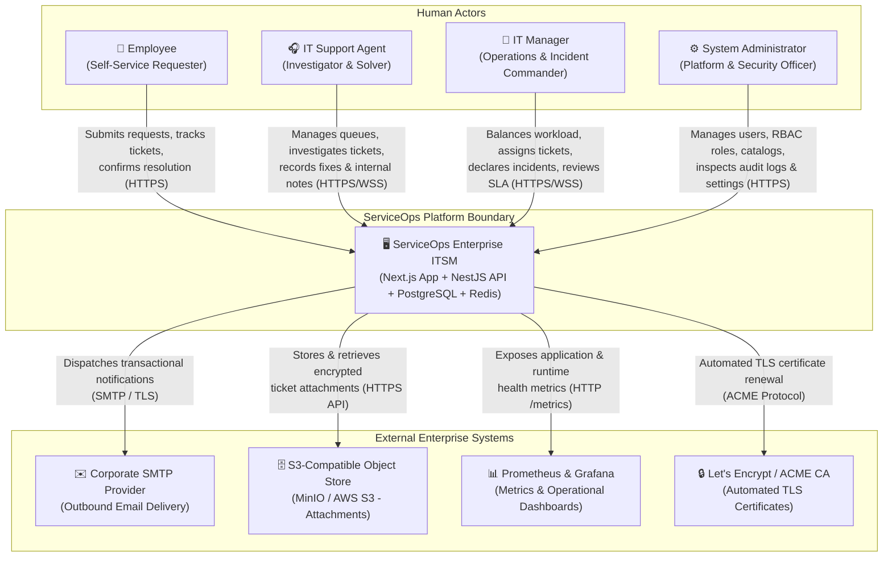
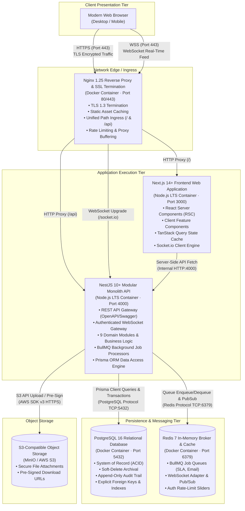
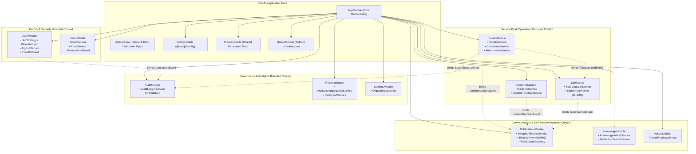
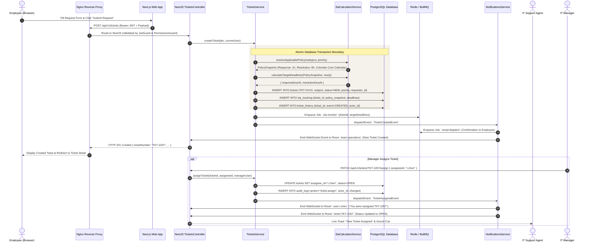

# ServiceOps Software Design Document (SDD)
## Phase 01: Architectural Foundation, Baseline Gap Analysis & System Topology

> **Document Version:** 1.0.0 (Phase 01 Deliverable)  
> **Classification:** Confidential — Internal Engineering Specification  
> **Status:** Completed — Pending Formal Review & Gating Approval  
> **Target System:** ServiceOps — Enterprise IT Service Management (ITSM) Platform  
> **Primary Author:** Principal Software Architect, Senior System Analyst, Business Analyst, Database Architect, UI/UX Architect & Technical Documentation Engineer  
> **Governing Baselines:**
> - Software Requirements Specification (SRS) v1.0 (`Docx/ServiceOps_SRS.docx`)
> - Software Project Proposal v1.0 (`Docx/ServiceOps_Project_Proposal.docx`)
> - Baseline System Architecture Design (SAD) v1.0 (`Docx/ServiceOps_System_Architecture_Design.docx`)
> - Database Design Specification v1.0 (`Docx/ServiceOps_Database_Design_Specification.docx`)
> - Interactive UI/UX Design System Prototype (`design/index.html`)

---

## 1. Document Control & Executive Summary

### 1.1 Document Metadata
| Field | Value |
| :--- | :--- |
| **Document Title** | ServiceOps Comprehensive Software Design Document — Phase 01 |
| **Document Identifier** | `SO-SDD-PHASE-01` |
| **Document Revision** | `2.0-DRAFT` (Targeting Implementation-Ready Baseline) |
| **Approved Architecture Style** | Modular Monolith (NestJS) + Decoupled Web Client (Next.js App Router) |
| **Approved Database System** | PostgreSQL 16 with Prisma ORM 5+ |
| **Approved Message Broker / Queue** | Redis 7 with BullMQ |
| **Approved Frontend Design System** | Tailwind CSS + shadcn/ui + Lucide Icons + Bespoke Editorial ITSM Theme |

### 1.2 Purpose of Phase 01
The objective of Phase 01 is to establish the **uncompromising architectural foundation** for the transformation of the preliminary System Architecture Design into a production-grade, implementation-ready Software Design Document. 

Existing project documentation contains significant functional and structural deficiencies: the baseline SAD is merely ~12KB in length, omitting essential component contracts, DTO schemas, role-specific interaction models, and detailed workflow state machines. Phase 01 bridges the gap between the business needs captured in the Project Proposal, the functional and non-functional requirements codified in the SRS, and the physical engineering execution required by developers, database administrators, and QA engineers.

---

## 2. Comprehensive Baseline Gap Analysis

A rigorous, evidence-based comparative audit was conducted across all existing project documents to identify missing designs, technical ambiguities, and architectural risks.

### 2.1 Functional Module Gap Matrix
The table below maps the 9 core modules defined in the Project Proposal (§5) and SRS (§3) against the existing System Architecture Design (SAD) baseline:

| Module Ref | Domain Module | SRS Requirements | Proposal Scope | Baseline SAD Coverage | Deficiencies & Gaps Identified |
| :---: | :--- | :--- | :--- | :--- | :--- |
| **MOD-01** | **Authentication & Security** | FR-AUTH-001 to 008<br>FR-RBAC-001 to 006 | Proposal §4, §5.9 | SAD §8 (12 lines of text) | **Severe:** No token rotation algorithm; no cookie security parameters; no failed-login throttling state machine; no permission bitmask/matrix specification. |
| **MOD-02** | **Helpdesk & Service Requests** | FR-TKT-001 to 012<br>BR-003, BR-004, BR-006, BR-012 | Proposal §5.1, §6 | SAD §5, §6.1 (Summary bullets) | **Critical:** No formal lifecycle state machine; no public vs internal comment isolation contracts; no upload validation pipeline; missing DTO specifications. |
| **MOD-03** | **Incident Management** | FR-INC-001 to 006 | Proposal §5.2 | SAD §5 (3 lines) | **Major:** Missing severity matrix (P1–P4); no incident commander escalation flow; no real-time war room architecture; no ticket-linking contracts. |
| **MOD-04** | **SLA Management Engine** | FR-SLA-001 to 009<br>BR-007, BR-008, BR-009 | Proposal §5.3 | SAD §5, §6.2 (Summary bullets) | **Critical:** Missing business calendar calculation engine; no holiday schedule data model; no BullMQ recurring job spec; no immutable snapshot algorithm. |
| **MOD-05** | **IT Asset Management** | Proposal §5.4<br>DB Spec §12 | Proposal §5.4 | SAD §5 (1 line) | **Major:** Asset tracking completely absent from SAD; no entity linkage to tickets; no lifecycle states for hardware assets. |
| **MOD-06** | **Knowledge Base & Self-Service** | Proposal §5.5<br>SRS §2.3 | Proposal §5.5 | SAD §5 (1 line) | **Major:** Article authoring lifecycle missing; no ticket deflection search mechanism; no feedback/CSAT rating model. |
| **MOD-07** | **Workforce & Assignment** | FR-TKT-004<br>BR-005 | Proposal §5.6 | SAD §5, §6.1 | **Major:** No workload capacity model; no routing rules; no agent queue vs manager assignment desk differentiation. |
| **MOD-08** | **Notifications & WebSocket** | FR-NOT-001 to 006 | Proposal §5.7 | SAD §5, §6.3 | **Major:** Multi-channel routing engine absent; no email template compilation design; WebSocket room taxonomy and auth handshake missing. |
| **MOD-09** | **Analytics & Reporting** | FR-REP-001 to 007 | Proposal §5.8 | SAD §5 (2 lines) | **Major:** No aggregation query architecture; no role-specific dashboard metrics; no streaming CSV/PDF generation pipeline. |
| **MOD-10** | **Audit & Administration** | FR-AUD-001 to 004<br>FR-ADM-001 to 003<br>BR-010 | Proposal §5.9 | SAD §5, §8 | **Critical:** No append-only database permission model; no JSON audit payload schema; no category taxonomy hierarchy; no backup verification. |

### 2.2 Role-Based Architectural Deficiencies
The SRS specifies four distinct user classes (§2.3: Employee, IT Support Agent, IT Manager, System Administrator). The baseline SAD treated all users as generic clients connecting to an API, completely failing to articulate:
1. **Employee Experience:** Zero specification of self-service deflection, request status tracking, resolution confirmation workflows (CSAT), or private comment concealment.
2. **Support Agent Experience:** No urgency lane queues, no separation between public replies and internal technical investigation notes, no root-cause classification tools.
3. **IT Manager Experience:** Missing team workload roster, soft-cap balancing algorithms, incident command coordination, and operational compliance reports.
4. **Administrator Experience:** Missing user invitation lifecycles, account unlock controls, SLA policy versioning, and tamper-evident audit log inspection.

---

## 3. Core Architectural Tenets & Standards

To ensure absolute technical consistency across all subsequent design phases, the following ten foundational tenets are formally established:

1. **Modular Monolith by Design:** The backend operates as a single deployable NestJS process containing strictly bounded modules. Cross-module database writes are forbidden; inter-module dependencies must occur via public service contracts or asynchronous domain events.
2. **Server-Side Authorization Authority:** The frontend never decides access; every API route, method, and WebSocket event verifies role, permission, and resource ownership at the server boundary.
3. **Single System of Record:** PostgreSQL 16 is the sole authoritative store of business data. Redis 7 is strictly an ephemeral queue broker, cache, and real-time pub/sub layer.
4. **Asynchronous Non-Blocking Processing:** External network calls (SMTP delivery, S3 uploads) and CPU-intensive operations (SLA calculations, report exports) must execute out-of-band via BullMQ queues to preserve API response times under 500ms (`NFR-PERF-001`).
5. **Idempotency & Resilient Retries:** All background workers must be idempotent and safe against duplicate processing. Failed external deliveries must utilize exponential backoff retries.
6. **Immutable Historical Records:** Core operational history (SLA snapshots, audit events, state transitions) must be append-only. Modifying policies or configurations must never alter past operational records (`BR-008`, `BR-010`).
7. **Leak-Proof Data Isolation:** Internal agent notes, credentials, and sensitive audit payloads must be physically excluded from serialization when serving Employee requests (`BR-006`).
8. **Decoupled Frontend Reactivity:** The Next.js frontend maintains a clear boundary between server-rendered layouts and dynamic client-rendered state, synchronizing with the backend via REST and WebSockets.
9. **Observability by Design:** Structured JSON logging (Winston), Prometheus metrics endpoints, and health probes (`/health/liveness`, `/health/readiness`) must be natively embedded in the application runtime.
10. **Single-Tenant Core with Multi-Tenant Readiness:** The initial deployment serves one organization (`Northwind Internal IT`), but all core tables include an `organization_id` foreign key to support seamless multi-tenant migration in future releases without data refactoring.

---

## 4. C4 Model — Level 1: System Context Architecture

The System Context diagram illustrates how the ServiceOps platform fits into the enterprise ecosystem, identifying all human actors and external service integrations.



### 4.1 Persona Interaction Contracts
- **Employee:** Interacts exclusively with public-facing request forms, the self-service knowledge base, and their own ticket threads. Restricted from viewing internal notes, agent assignment queues, operational metrics, or audit logs.
- **IT Support Agent:** Accesses urgency-sorted ticket queues, updates ticket lifecycles, composes public replies and private internal notes, claims unassigned tickets, and authors draft knowledge guides.
- **IT Manager:** Holds organizational oversight. Oversees the assignment desk, monitors real-time agent capacity, reassigns tickets, declares major incidents, manages SLA policies, and exports operational compliance reports.
- **System Administrator:** Governs identity, roles, categories, organization settings, and compliance. Reviews security lockouts, manages database backups, and inspects the immutable audit log.

---

## 5. C4 Model — Level 2: Container Architecture

The Container Architecture decomposes the ServiceOps platform into its distinct runtime containers, protocols, and data stores.



### 5.1 Container Technical Specifications
| Container | Technology / Runtime | Primary Function | Concurrency & Scaling Strategy | Inbound / Outbound Protocols | Security Controls |
| :--- | :--- | :--- | :--- | :--- | :--- |
| **Edge Ingress** | Nginx 1.25 on Alpine Linux | Reverse proxy, SSL termination, static gzip/brotli caching, security headers. | Event-driven non-blocking worker pool. Handles 10k+ concurrent connections. | In: HTTPS (443), HTTP (80)<br>Out: HTTP (3000, 4000) | TLS 1.3, HSTS, CSP headers, rate-limiting (30 req/sec on auth). |
| **Frontend Web** | Next.js 14+ (Node.js 20 LTS) | Server-rendered pages, layout skeletons, reactive UI widgets, client state. | Stateless container; scale horizontally behind load balancer if needed. | In: HTTP (3000)<br>Out: HTTP (4000), WSS | Nonce-based CSP, sanitization of rendered inputs, zero secrets in client bundles. |
| **Backend API** | NestJS 10+ (Node.js 20 LTS) | Core business logic, validation pipes, JWT/RBAC guards, BullMQ processors. | Event-loop based; BullMQ worker concurrency tuned to CPU cores (concurrency: 5). | In: HTTP (4000), WSS<br>Out: TCP (5432), TCP (6379) | Argon2id, JWT validation, parameterized SQL (Prisma), input DTO whitelisting. |
| **Relational DB** | PostgreSQL 16 on Debian Linux | Primary transactional persistence store of record. | Connection pooling via Prisma (max: 30 connections); vacuuming tuned. | In: TCP (5432)<br>Out: None (Isolated) | Network-isolated Docker network; encrypted volume; revokes UPDATE/DELETE on audit. |
| **Queue / Cache** | Redis 7 on Alpine Linux | Message broker for BullMQ, WebSocket pub/sub, rate limit state. | Single-threaded in-memory engine with AOF persistence enabled. | In: TCP (6379)<br>Out: None (Isolated) | Password authentication (`requirepass`); isolated internal network; memory cap. |
| **Object Store** | MinIO / AWS S3 API | Unstructured binary attachment storage. | Scalable chunked multi-part streaming storage. | In: HTTPS (9000)<br>Out: None | Pre-signed expiring URLs (15 min); antivirus scanning before permanent commit. |

---

## 6. Modular Monolith Logical Domain Decomposition (C4 Level 3)

The NestJS backend is architected as a modular monolith. To maintain extreme maintainability, prevent circular dependencies, and enable future microservice decoupling if desired, the application is partitioned into nine bounded domain modules.



### 6.1 Domain Module Responsibilities & Public Contracts
1. **`AuthModule`:** Responsible for authentication lifecycle (sign-in, refresh token rotation, logout, password reset, lockout evaluation). Exposes `AuthService` and `JwtAuthGuard`.
2. **`UsersModule`:** Manages user accounts, profile metadata, role assignments (`Employee`, `Agent`, `Manager`, `Administrator`), and atomic permission resolution. Exposes `UsersService` and `RbacGuard`.
3. **`TicketsModule`:** Core service request lifecycle management. Owns ticket creation, assignments, state machine transitions, public comments, restricted internal notes, and attachments.
4. **`IncidentsModule`:** Oversees major unplanned service disruptions. Governs severity classification (P1–P4), incident commander assignment, investigation timeline updates, and linking customer requests.
5. **`SlaModule`:** Computes and tracks service level agreements. Resolves business hours, evaluates pending pause intervals, maintains immutable policy snapshots, and runs BullMQ SLA monitoring jobs.
6. **`NotificationsModule`:** Multi-channel notification pipeline. Manages the in-app notification inbox, processes asynchronous outbound SMTP emails via BullMQ, and broadcasts real-time events over WebSockets.
7. **`AssetsModule`:** Hardware and IT equipment inventory. Associates physical devices (laptops, docks, monitors) with users and support tickets.
8. **`KnowledgeModule`:** Self-service article catalog. Handles article draft/publish workflows and delivers search suggestions to deflect duplicate tickets.
9. **`AuditModule` & `ReportsModule`:** Compliance and analytics. Writes append-only immutable audit records, aggregates performance KPIs (MTTR, compliance rates), and streams CSV export reports.

---

## 7. End-to-End Runtime Workflow Foundation

To illustrate the seamless cohesion of the containers and modules, the architectural sequence for the fundamental **Service Request Creation, SLA Locking, and Assignment Workflow** is formally specified:



---

## 8. Master Software Design Document (SDD) Structure

To ensure complete, rigorous coverage of all requirements across the subsequent phases, the master table of contents for the implementation-ready SDD is established:

```
ServiceOps Master Software Design Document (SDD v2.0) Table of Contents:
├── Section 01: Architectural Foundation, Scope & System Context (Phase 01)
├── Section 02: Core Security Architecture, Authentication & RBAC Matrix (Phase 02)
├── Section 03: Helpdesk & Service Request Management Module Design (Phase 03)
├── Section 04: Incident Management & Outage Command Architecture (Phase 04)
├── Section 05: SLA Engine, Business Calendars & Escalation Workflow (Phase 05)
├── Section 06: Notifications, Multi-Channel Email & WebSocket Architecture (Phase 06)
├── Section 07: IT Asset Management & Self-Service Knowledge Base (Phase 07)
├── Section 08: Operational Dashboards, Analytics & Reporting Architecture (Phase 08)
├── Section 09: System Administration, Audit Logging & Platform Governance (Phase 09)
├── Section 10: Frontend Architecture, Component Hierarchy & UI/UX Specs (Phase 10)
├── Section 11: Deployment Topology, Infrastructure & DevSecOps Architecture (Phase 11)
└── Section 12: Comprehensive Traceability Matrix & Master Sign-Off (Phase 12)
```

---

## 9. Phase 01 Verification & Compliance Audit

Phase 01 has been audited against the primary source requirements:
- **SRS Scope Alignment (§1, §2):** Single-organization architecture verified; future multi-tenancy readiness preserved via tenant partition foreign key convention (`ISSUE-001`).
- **External Interfaces (§4):** Full Next.js REST, WebSocket gateway, PostgreSQL via Prisma, Redis/BullMQ, SMTP, and S3 object storage specifications codified.
- **Business Rules Compliance (§6):** Foundations established for default employee role (`BR-001`), server-side admin role restriction (`BR-002`), unique public ticket identifiers (`BR-003`), internal note isolation (`BR-006`), immutable SLA snapshots (`BR-008`), and append-only audit logs (`BR-010`).
- **Tech Stack Integrity:** Zero deviations from the approved stack (Next.js, NestJS, PostgreSQL, Prisma, Redis/BullMQ, Nginx, Docker).

---

## 10. Phase 01 Completion Sign-Off & Next Steps

Phase 01 is fully generated, deeply reasoned, and recorded in the persistent project repository.

- **Completed Deliverables:**
  1. Master Progress Tracker: [`docs/sdd/00_MASTER_PROGRESS_TRACKER.md`](file:///d:/Project/ServiceOps/docs/sdd/00_MASTER_PROGRESS_TRACKER.md)
  2. Central Decisions & Issues Register: [`docs/sdd/00_CENTRAL_DECISIONS_AND_ISSUES_REGISTER.md`](file:///d:/Project/ServiceOps/docs/sdd/00_CENTRAL_DECISIONS_AND_ISSUES_REGISTER.md)
  3. Phase 01 Design Specification: [`docs/sdd/PHASE_01_ARCHITECTURAL_FOUNDATION_AND_GAP_ANALYSIS.md`](file:///d:/Project/ServiceOps/docs/sdd/PHASE_01_ARCHITECTURAL_FOUNDATION_AND_GAP_ANALYSIS.md)
- **Active ADRs Established:** ADR-001 through ADR-010.
- **Active Issues Tracked:** ISSUE-001 through ISSUE-006.

**Pending Action:** Awaiting user formal review and approval (`APPROVE PHASE`). Upon approval, Phase 02 (**Core Security, Authentication & Role-Based Access Control Architecture**) will be executed.

